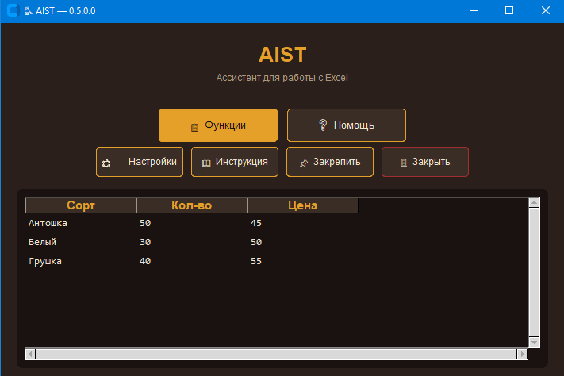
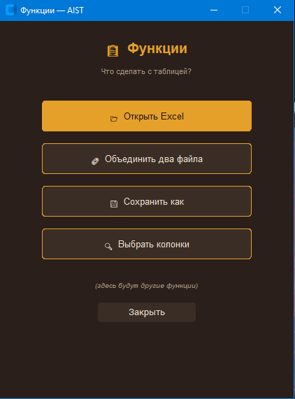
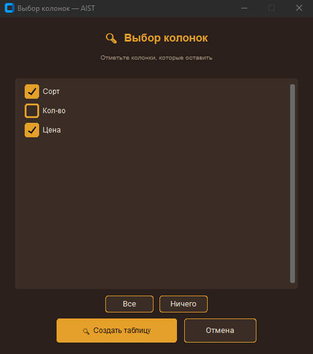

# 🐦 AIST — Ассистент для работы с Excel

AIST (Artificial Intelligence Search Tables) — это настольное приложение для автоматизации рутинной работы с таблицами Excel. Программа создана для помощи бухгалтерам, экономистам и всем, кто ежедневно сталкивается с обработкой больших объемов данных.

## ✨ Основные возможности

## 📸 Скриншоты

Программа берет на себя самую скучную и долгую работу:
* 🧹 Умная очистка — AIST автоматически находит и удаляет пустые строки и колонки, а также распознает заголовки, даже если файл «грязный».
* 🔗 Объединение — склеивает несколько таблиц в одну, автоматически находя и удаляя дубликаты строк.
* 🔍 Выбор колонок — позволяет оставить в таблице только нужные столбцы, отсекая лишнюю информацию.
* 💾 Сохранение результата — выгружает готовый отчет в новый файл. 
* 🛡️ Безопасность — программа никогда не изменяет исходные файлы. Вы всегда можете быть уверены в сохранности ваших данных.

## 💻 Как запустить

Для обычных пользователей:
1. Скачайте последнюю версию AIST.exe в разделе Releases.
2. Запустите файл двойным кликом.
3. Программа работает автономно (не требует установки Python).

*Требования: Windows 10 или 11 (64-bit).*

Для разработчиков:
1. Склонируйте репозиторий.
2. Создайте виртуальное окружение и установите зависимости: pip install pandas openpyxl customtkinter pillow.
3. Запустите python aist.py.

## 🛠️ Стек технологий

* Язык: Python 3.12
* Работа с данными: pandas, openpyxl
* Интерфейс: CustomTkinter, Tkinter
* Графика: Pillow (PIL)
* Сборка: PyInstaller

## 🦉 Планы по развитию (Roadmap)

Проект активно развивается и когда-нибудь превратится в целую экосистему «Птичья вселенная».
* [x] v0.5.0 — Базовый функционал, таблицы, выбор колонок.
* [x] v0.6.0 — Своды, группировки и автоматические суммы.
* [ ] v1.0.0 — Стабильный релиз, сборка красивого интерфейса.
* [ ] v2.0.0 — Создание хаба «Филин» и модуля складского учета «Сойка».

## 👨‍💻 Автор

Создано с душой и любовью к чистому коду. 
GitHub: [@artm-lupa](https://github.com/artm-lupa)

## 📄 Лицензия

Этот проект распространяется под лицензией, описанной в файле [LICENSE.txt](LICENSE.txt).